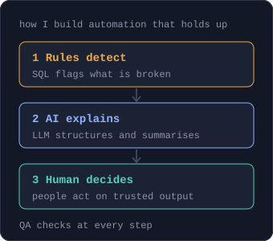
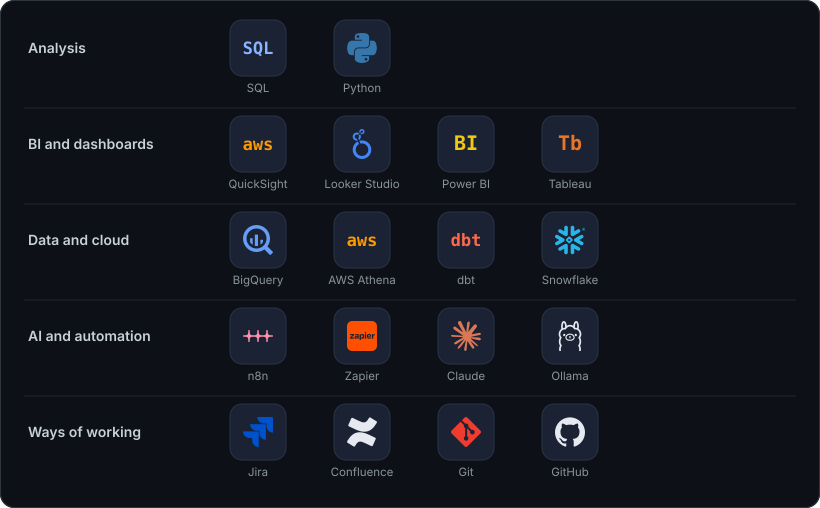

  

  

<h2 align="center">Data &amp; Automation Analyst with a QA backbone</h2>

<i>I turn messy manual operations into trusted, automated reporting and AI workflows that teams actually use.</i>

  
  
  

---

<h2 align="center">🚀 About Me</h2>

<table width="100%">
<tr>
<td width="45%" valign="top">

### 👨‍💻 Who am I?

* 🧪 **Started in QA**, moved into **data analytics**, now building with **low-code and AI**.
* 🔧 I fix the messy, manual parts of a business: the **spreadsheets nobody trusts**, the **tickets nobody sorts**, the **reports that eat half a day**.
* 🤝 The bridge between technical and non-technical teams across **Product, Operations, Finance and Customer Success**.
* 🚚 Most of my work has been in **last-mile logistics and e-commerce**, and I'm open to any domain with a messy process worth fixing.
* 📍 Based in **Berlin**. English fluent, German verhandlungssicher.

<blockquote>
  <i>"I don't stop at something that demos well. I stop when it holds up."</i>
</blockquote>

</td>
<td width="55%" align="center" valign="middle">

</td>
</tr>
</table>

---

### 🏅 Achievements

* 🏗️ **Built the data function from scratch** at Bettermile (GLS eCom Lab)
* 📈 **Progressed from QA Engineer to Junior Data Analyst** at Bettermile
* 🤝 **Launched and led the internal Data Guild** and a global KPI dashboard
* 🎓 **MSc in Data Analytics**
* 🚀 **Le Wagon Data Analytics Bootcamp**, March 2025
* 🤖 **Anthropic Claude 101** certificate

---

### 🎯 What I fix for your team

| Your problem | What I build | Proof |
|---|---|---|
| Reports that eat half a day | Reporting structure and automated dashboards | Bettermile: **50% less analysis time** |
| Slow, manual recurring processes | SQL and workflow automation | Bettermile: benchmarking **30% faster** |
| Defects and data nobody trusts | Automated validation checks and tagging rules | Bettermile: **40% fewer user-reported defects** |
| Money leaking through a broken process | Root-cause analysis and finance reporting | Bettermile: traced a billing and API-tracking gap, **revenue accuracy +5%** |
| Unstructured requests and late exceptions | LLM triage and exception monitoring | The two AI builds below |

---

### ⚡ Tech Stack

  

---

### 💼 Featured Builds

<table>
<tr>
<td width="50%" valign="top">

#### 🤖 [Vet Tele-Health AI Ticket Triage](https://github.com/mistryamit03/vet-telehealth-ai-ticket-triage)

**Problem:** support messages arrive unstructured, so manual triage is slow and inconsistent. 
**Built:** a local LLM with schema-constrained output sorts 300 messy tickets into category, priority and a one-line summary, then SQL analyses the workload. 
**Result:** 300 of 300 tickets structured, zero invalid labels. Accuracy is deliberately not claimed: schema-valid is not the same as correct.

`Python` `Ollama` `Llama 3.2` `SQLite` `SQL`

</td>
<td width="50%" valign="top">

#### 🚨 [Margin and Shipping Exception Monitor](https://github.com/mistryamit03/AI_Assisted_Margin_and_Shipping_Exception_Monitor)

**Problem:** loss-making orders and late shipments are spotted too late, and reviewed by hand. 
**Built:** SQL rules flag exceptions in BigQuery, a memory table separates new from known issues, n8n routes each run to ALERT or MONITOR, and a local LLM emails a plain-English summary. 
**Result:** one manual run surfaces what matters and what to do next.

`BigQuery` `SQL` `n8n` `Ollama` `Looker Studio`

</td>
</tr>
<tr>
<td width="50%" valign="top">

#### 🎮 [Gamelytics KPI Console](https://github.com/mistryamit03/gamelytics-powerbi)

**Problem:** product teams need one view of engagement, monetisation and retention. 
**Built:** a Power BI model over 1M users, 9.6M logins and 405K A/B records, covering DAU/MAU, ARPU and D1/D7/D30 cohorts. 
**Result:** a documented KPI console with data lineage and DAX measures.

`Power BI` `DAX` `Data modelling`

</td>
<td width="50%" valign="top">

#### 🏠 [Prello Real Estate ELT](https://github.com/mistryamit03/Data-Analytics-End-to-End-Project---Prello)

**Problem:** raw property data is not decision-ready. 
**Built:** a group project pipeline moving raw data through staging and mart layers in dbt on BigQuery, reported in Looker Studio. 
**Result:** clean, tested models ready for analysis.

`dbt` `BigQuery` `SQL` `Looker Studio`

</td>
</tr>
</table>

Also: [GORNATION Growth Analytics](https://github.com/mistryamit03/Gornation-calisthenics-growth-analytics), marketing and fulfilment analytics for a calisthenics brand (simulated data).

---

### 🐍 Contribution Activity

  <picture>
    <source media="(prefers-color-scheme: dark)" srcset="https://raw.githubusercontent.com/mistryamit03/mistryamit03/output/github-contribution-grid-snake-dark.svg" />
    
  </picture>

---

### 🏋️ Off the clock

I train calisthenics, chasing the planche. Same discipline as the work: show up, iterate, don't fake the rep.

<b>Got a messy process that needs fixing?</b> <a href="mailto:mistryamit03@gmail.com">Let's talk.</a>

